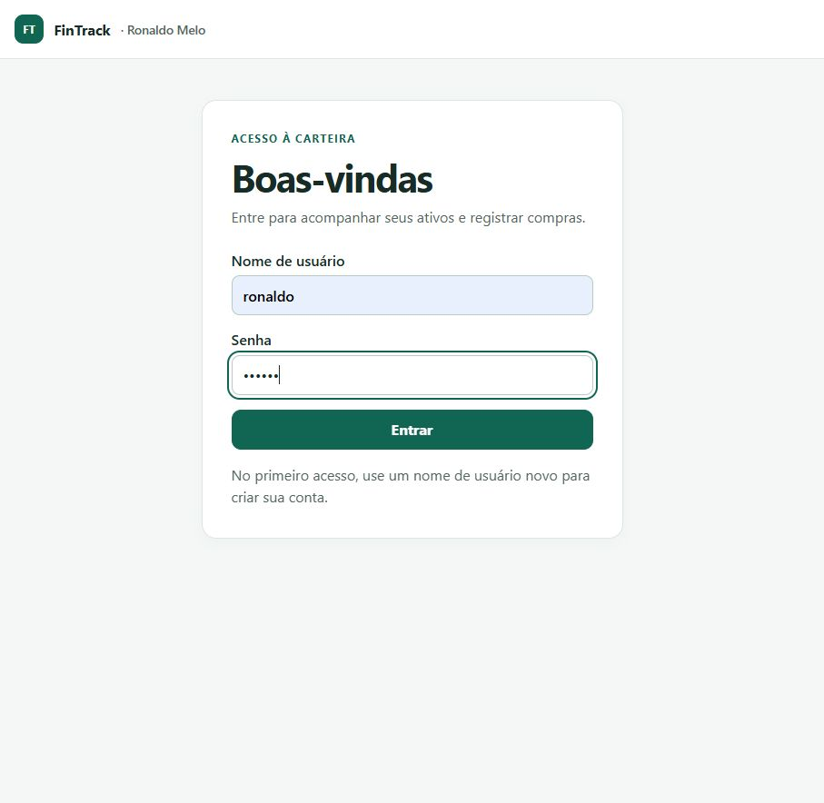
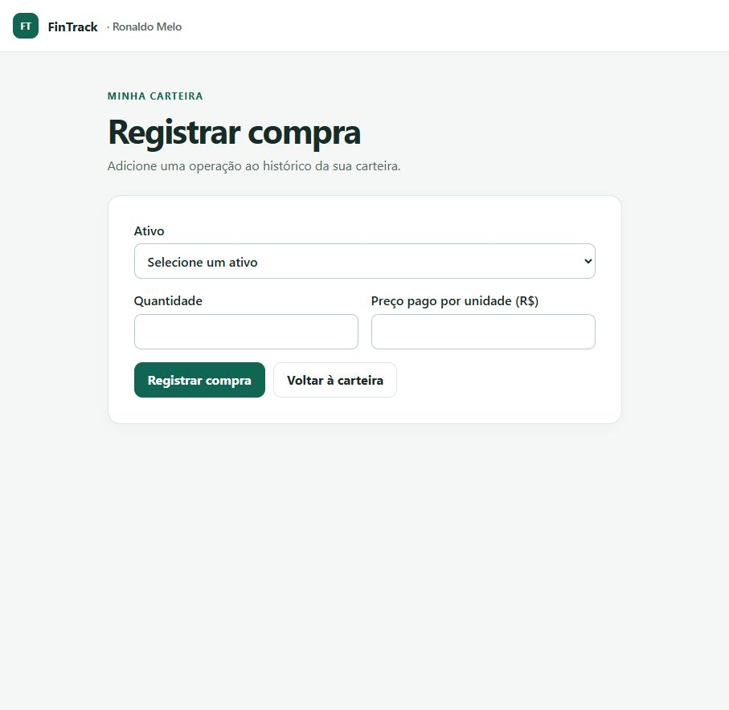
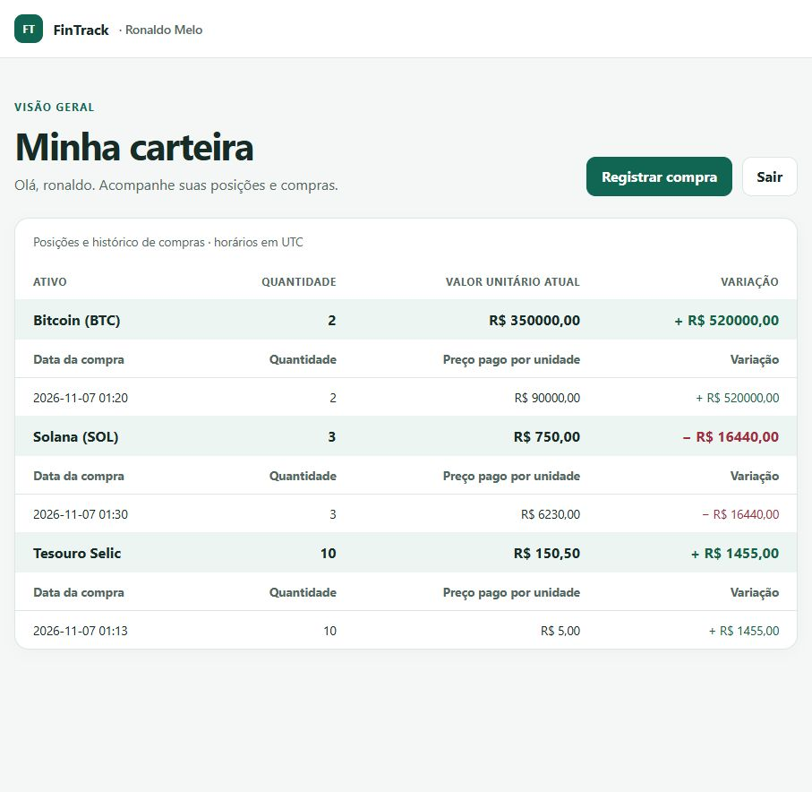
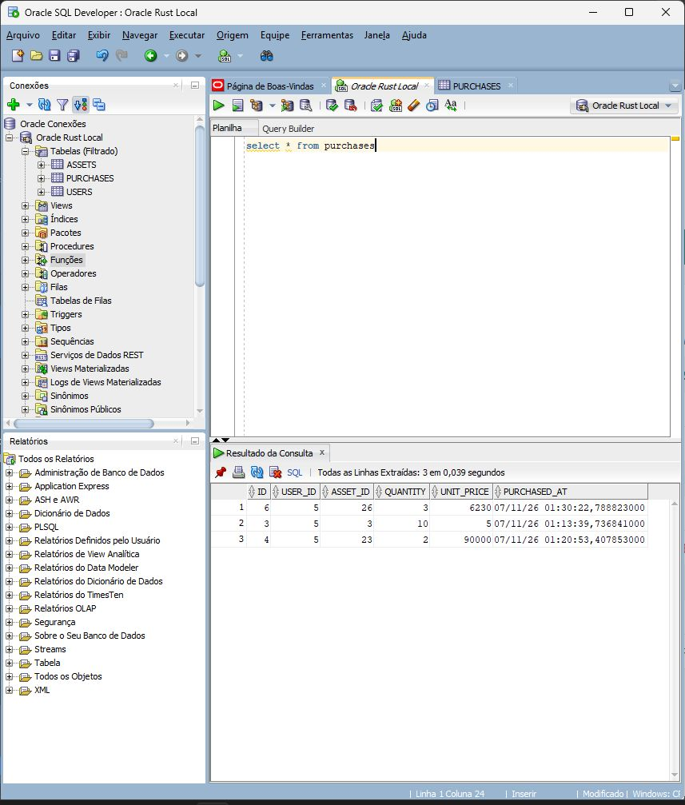
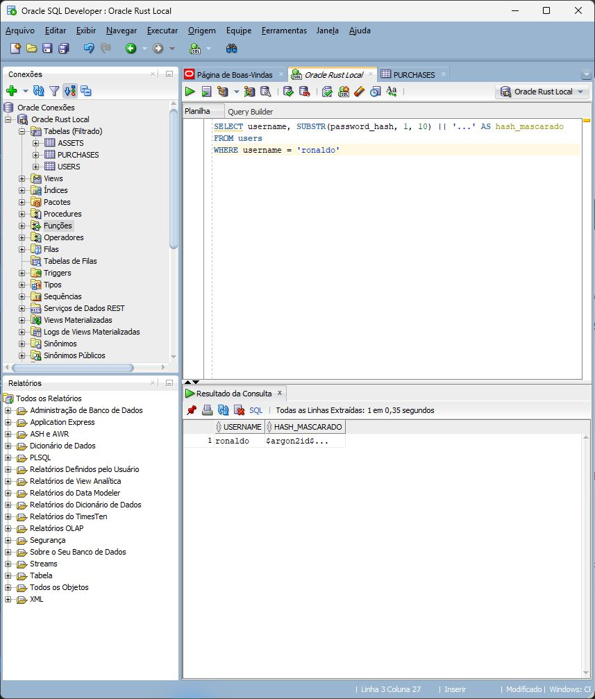

# FinTrack · Carteira de Investimentos

**Criador desta versão:** Ronaldo Melo

Aplicação fullstack em Rust para cadastrar e consultar ativos de investimento. Após o login, a interface web mostra a carteira do usuário, com posições, variação e histórico de compras. A API lista, cria e atualiza os ativos disponíveis no catálogo.

## Telas do FinTrack

### Login



### Registrar compra



### Carteira



## Dados no Oracle

### Compras gravadas

A consulta no SQL Developer mostra as compras registradas em `PURCHASES`, com o usuário, o ativo, a quantidade, o preço pago por unidade e a data da operação.



### Hash da senha

A tabela `USERS` guarda o hash Argon2id da senha. A consulta exibe apenas o prefixo do hash.



## Tecnologias e estrutura MVC

- **Model** — `src/models.rs` define ativos, usuários e compras. `src/repository.rs` concentra consultas e transações Oracle. `src/db.rs` configura o pool de conexões e executa o driver síncrono fora das threads assíncronas do Tokio.
- **View** — `templates/` contém os templates HTML renderizados pelo Askama.
- **Controller** — `src/routes/` contém os handlers Axum da API e da interface web. `src/auth/` implementa a autenticação com cookies, JWT e hash de senha.
- **Inicialização** — `src/app.rs` monta a aplicação. `migrations/` contém o SQL versionado do Oracle Database.

A melhoria do desafio foi trocar PostgreSQL e SQLx pelo Oracle Database Free 26ai do Docker, usando o driver [`oracledb`](https://github.com/oracle/rust-oracledb). O driver dispensa a instalação do Oracle Instant Client.

## Como executar

Use Rust com Cargo e um Oracle Database Free 26ai em execução. A configuração de exemplo usa o contêiner `oracle26ai`, a porta publicada `1521` e o serviço `FREEPDB1`.

```powershell
docker ps --filter name=oracle26ai
if (-not (Test-Path .env)) { Copy-Item .env.example .env }
```

Se o schema `fintrack` ainda não existir, entre no SQL*Plus com acesso administrativo local.

```powershell
docker exec -it oracle26ai sqlplus / as sysdba
```

No SQL*Plus, troque a senha de exemplo antes de executar.

```sql
ALTER SESSION SET CONTAINER = FREEPDB1;
CREATE USER fintrack IDENTIFIED BY "substitua_pela_sua_senha"
    DEFAULT TABLESPACE USERS QUOTA 50M ON USERS;
GRANT CREATE SESSION, CREATE TABLE, CREATE SEQUENCE TO fintrack;
EXIT
```

Preencha o `.env` com a senha do schema. Copie as migrações para o contêiner e entre como o usuário da aplicação. O SQL*Plus solicitará a senha.

```powershell
docker cp migrations/001_create_tables.sql oracle26ai:/tmp/fintrack-schema.sql
docker cp migrations/002_create_purchases.sql oracle26ai:/tmp/fintrack-purchases.sql
docker exec -it oracle26ai sqlplus fintrack@//localhost:1521/FREEPDB1
```

```sql
@/tmp/fintrack-schema.sql
@/tmp/fintrack-purchases.sql
EXIT
```

As migrações podem ser reaplicadas. Em seguida, execute `cargo run --locked` e abra [a página de login](http://localhost:3000/login). O primeiro login com um nome novo cria a conta. O login leva à carteira em `/assets`.

Na carteira, use **Registrar compra** para selecionar um ativo do catálogo e informar a quantidade e o preço pago por unidade. O histórico fica vinculado ao usuário autenticado. A variação é a diferença entre o valor unitário atual do catálogo e o preço pago, multiplicada pela quantidade comprada. O painel soma as variações das compras por ativo.

## Como testar

Com o Oracle ativo, as credenciais no `.env` e as migrações aplicadas, execute:

```powershell
cargo test --locked -- --include-ignored
```

O teste de integração verifica operações de ativos, autenticação, registro de compra, cálculo de variação e filtragem do histórico pelo usuário. Ao terminar, ele limpa os registros que criou.

Para testar pela API com a aplicação em execução:

```powershell
$base = 'http://localhost:3000/api/assets'
$headers = @{ Authorization = 'im-the-admin' }
$asset = Invoke-RestMethod $base -Method Post -Headers $headers -ContentType 'application/json' -Body (@{
    name = "Ativo de teste $([guid]::NewGuid())"
    unit_value = 10.5
} | ConvertTo-Json)
Invoke-RestMethod $base
Invoke-RestMethod $base -Method Patch -Headers $headers -ContentType 'application/json' -Body (@{
    id = $asset.id
    unit_value = 20.5
} | ConvertTo-Json)
```

A chave de administração acima é a credencial de demonstração do projeto-base, usada nos testes locais.

## O que aprendi

A adaptação mostrou como separar a persistência dos controladores e da interface, parametrizar consultas Oracle, gerar IDs com sequences e controlar transações explícitas. Também mostrou como integrar um driver síncrono a uma aplicação assíncrona sem bloquear as threads que atendem às requisições.
